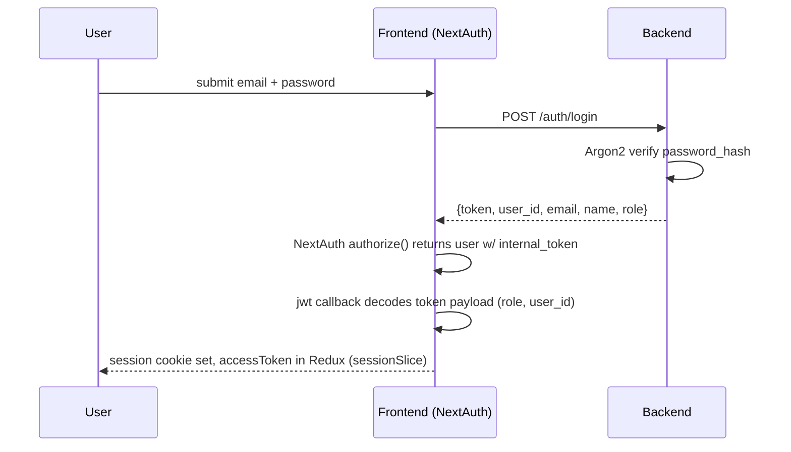
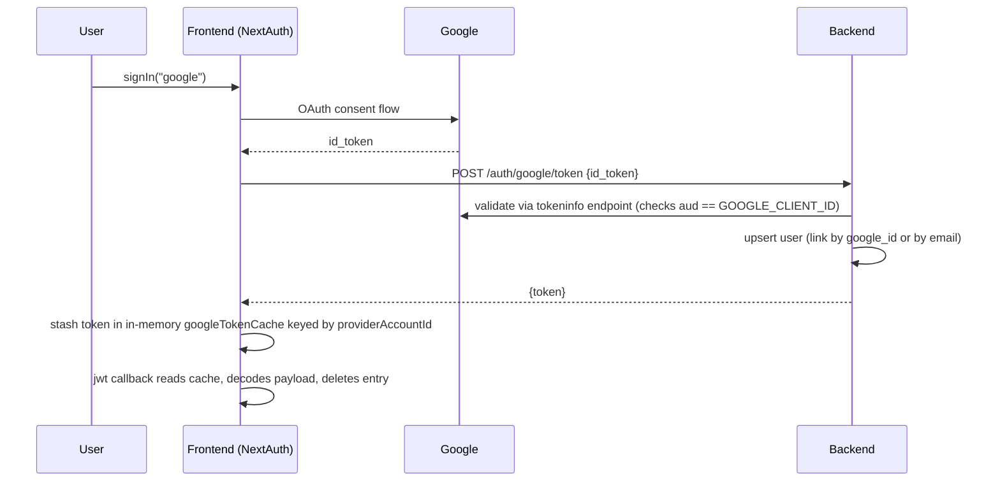
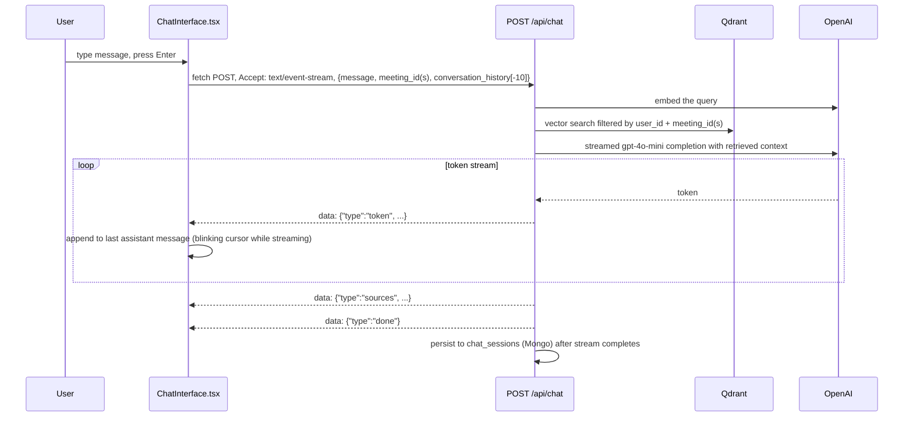
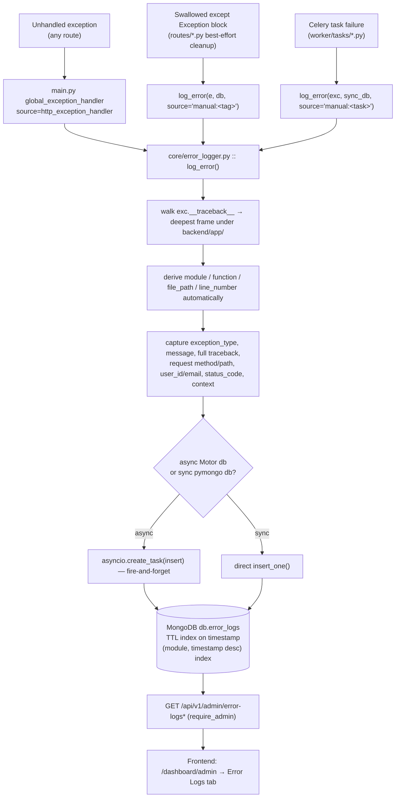
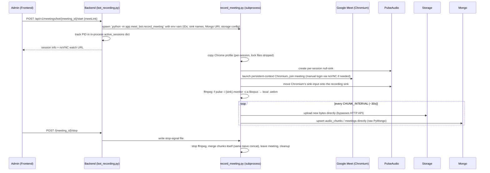

# Data Flow & Sequence Diagrams

## 1. Authentication

### Email + password



### Google OAuth (via NextAuth)



JWT payload: `{user_id, email, role, auth_provider, google_id, iat, exp}`, HS256, default 7-day expiry. Logout blacklists the token in Redis for its remaining TTL (`auth/jwt.py::get_current_user` checks `blacklist:{token}` on every request).

## 2. Recording → transcript → RAG → generation

```mermaid
sequenceDiagram
    participant C as Client
    participant API as Backend
    participant Storage as S3 / local disk
    participant Mongo
    participant Ext as External transcript source
    participant Qdrant
    participant OpenAI

    C->>API: POST /api/v1/meetings/ 
    API->>Mongo: insert meeting doc
    loop chunk upload (every ~30s)
        C->>API: POST /{id}/chunks (chunk_id, timestamp, audio)
        API->>Mongo: upsert audio_chunks, meeting.status=recording, audio_state=chunked
    end
    C->>API: POST /{id}/merge-chunks
    API->>API: naive bytearray concatenation of all chunks (no format detection)
    API->>Storage: write merged audio object
    API->>Mongo: push processing_queue entry
    Ext->>API: PATCH /{id} {transcript, X-Backend1-Signature?}
    API->>API: verify HMAC if BACKEND1_HMAC_SECRET set
    API->>Mongo: store transcript; null out mom/summary/key_points/diagram/rag_indexed
    API->>API: _index_transcript_inline() runs in a thread executor
    API->>Qdrant: delete old points for meeting_id, then upsert new embeddings (batches of 100)
    API->>Mongo: rag_indexed=true, rag_indexed_at
    API->>API: enqueue send_transcription_ready_email (Celery, only on first transcript_ready transition)
    C->>API: POST /{id}/generate/mom (or summary/key_points/diagram)
    API->>OpenAI: inline completion (gpt-4o-family, per-type prompt)
    API->>Mongo: store result
    API-->>C: 200 with generated content
```

!!! warning "Merge is always naive concatenation"
    The root README describes format detection (WebM vs MP4) with an ffmpeg re-mux path for mobile chunks. The actual code in `routes/meetings.py::merge_audio_chunks` does **not** do this — it always does a plain `bytearray` concatenation, for every client. `ffmpeg` in this codebase is used only inside the Meet Bot to *record* from PulseAudio, never to *merge* chunks. See [Known Issues](../operations/known-issues.md).

## 3. Chat (RAG) — SSE streaming



!!! note "This SSE parser is implemented three times independently"
    `hooks/useChatStream.ts`, `store/slices/chatSlice.ts`'s `sendMessage` thunk, and `ChatInterfaceRedux.tsx` (via `useChatRedux`) each contain their own copy of this fetch-and-parse loop. Only `useChatStream.ts` is on the live path (`ChatInterfaceRedux.tsx` isn't rendered by any page). See [Known Issues](../operations/known-issues.md).

## 4. Error logging pipeline



`log_error()` never raises and never blocks the caller — see [Error Logging System](../backend/error-logging.md) for the exact function contract.

## 5. Meet Bot recording (in-process module)



See [Meet Bot Module](../backend/meet-bot.md) for why login is manual (not token-based), and [Meet Bot Integration Service](../services/meet-bot-integration.md) for the separate standalone copy of this same logic.
