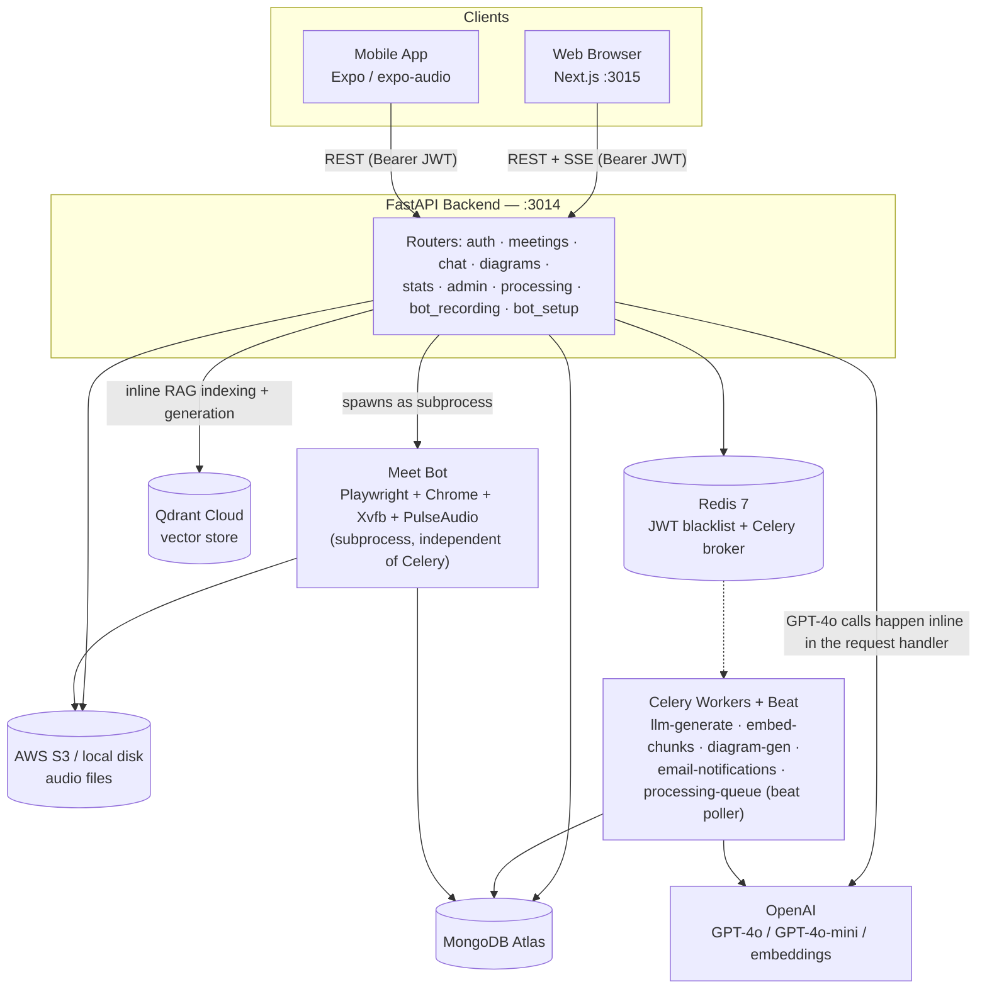
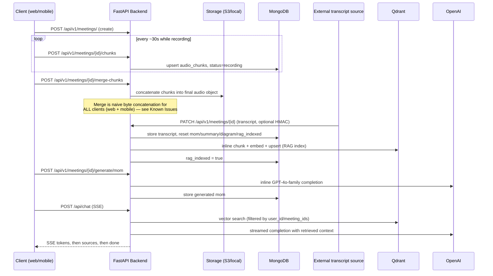

# Architecture Overview

## System diagram



**Read this diagram carefully — the two most important, easy-to-miss facts about this system:**

1. **AI generation is synchronous, not queued.** `POST /api/v1/meetings/{id}/generate/{type}` (MoM, Summary, Key Points, Diagram) and transcript-triggered RAG indexing both call OpenAI **inline inside the FastAPI request handler**, blocking the HTTP response until the model replies. The Celery tasks in `worker/tasks/` that do the *same* jobs exist and work, but are only reached via a narrower set of triggers (`POST /chat/reindex/{id}`, `POST /diagrams/{id}/regenerate`). See [Background Workers](../backend/workers.md).
2. **The Meet Bot is not a Celery task.** It's a plain OS subprocess (`python -m app.meet_bot.record_meeting`) spawned directly by `routes/bot_recording.py` and tracked in an in-process dict — it survives independently of the Celery worker/beat processes. See [Meet Bot Module](../backend/meet-bot.md).

## Request flow for a typical meeting



## Technology stack

### Backend

| Component | Technology |
|---|---|
| API framework | FastAPI (Python 3.11), Uvicorn |
| Database | MongoDB Atlas via Motor (async) / PyMongo (sync, in Celery + the meet bot) |
| Cache / broker | Redis 7 |
| Task queue | Celery + Celery Beat |
| LLM | OpenAI GPT-4o, GPT-4o-mini (model string is inconsistent across call sites — see [Known Issues](../operations/known-issues.md)) |
| Embeddings | OpenAI `text-embedding-3-small`, 1536 dims |
| Vector store | Qdrant Cloud |
| Audio storage | AWS S3 (IAM role) or local filesystem, hot-swappable at runtime |
| Auth | JWT (HS256, python-jose) + Argon2 password hashing + Google OAuth 2.0 |
| Automation | Playwright + Chromium + Xvfb + PulseAudio + ffmpeg (Meet Bot) |
| Containers | Docker + Docker Compose |

### Frontend

| Component | Technology |
|---|---|
| Framework | Next.js 14.2, App Router |
| Language | TypeScript |
| Styling | Tailwind CSS v3 |
| Auth | NextAuth v5 (beta) — Credentials + Google providers |
| Server state | TanStack React Query v5 |
| Client state | Redux Toolkit v2 — **7 slices**, not 3 (session, meetings, ui, admin, chat, recording, notifications) |
| HTTP | Axios (single instance, request-interceptor JWT injection) |
| Diagrams | Mermaid.js v11, dynamically imported |
| Exports | html2canvas / html2pdf.js (diagram → PNG/PDF) |

## Auxiliary services (not covered by the root README)

| Service | Role |
|---|---|
| `meet-bot-integration/` | A **standalone**, separately-deployed copy of the Meet Bot (own Docker stack, ports 4001/4002) — not currently called over HTTP by the backend. See [Meet Bot Integration Service](../services/meet-bot-integration.md). |
| `transcription_service/` | Currently a **mock/stub** — the real WhisperX+Pyannote pipeline is fully commented out. See [Transcription Service](../services/transcription-service.md). |

## Repository layout

```text
smart-mom-production/
├── backend/            FastAPI app, Celery workers, Meet Bot module
├── frontend/            Next.js 14 App Router client
├── meet-bot-integration/  Standalone Meet Bot microservice (parallel implementation)
├── transcription_service/  Mock transcription callback service
├── documentation/        This handbook — self-contained, own Dockerfile/compose
│   ├── docs/               MkDocs source (this site)
│   ├── mkdocs.yml
│   └── mcp-server/         Local MCP server exposing this handbook
├── .mcp.json              Claude Code MCP config (must stay at repo root)
└── opencode.json          OpenCode MCP config (must stay at repo root)
```

See [Backend → Overview & Structure](../backend/overview.md) and [Frontend → Overview & Structure](../frontend/overview.md) for the full file trees.
