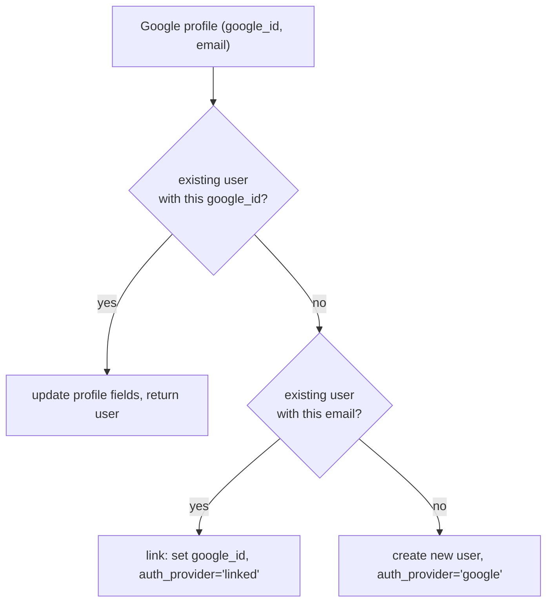

# Authentication & Authorization

## Two independent sign-in methods

### Email + password (`auth/routes.py`)

- Passwords hashed with **Argon2** (`passlib.CryptContext(schemes=["argon2"])`).
- `POST /auth/register`: checks email uniqueness; if an existing **Google-only** account shares the email, it auto-links the password to it (`auth_provider` becomes `"linked"`, `email_verified=True`).
- `POST /auth/login`: returns the **same error** (`INVALID_CREDENTIALS`) whether the email doesn't exist or the password is wrong (prevents user enumeration). A Google-only account attempting password login gets a distinct `GOOGLE_ACCOUNT` 400 error.
- Password strength (both client- and server-side): 8+ chars, ≥1 uppercase, ≥1 digit.

### Google OAuth 2.0 — three entry points, one upsert function

1. **`GET /auth/google` → `GET /auth/google/callback`** — classic server-redirect flow. State CSRF token stored in Redis (600s TTL). On callback: validate state, exchange code, fetch profile, upsert user, redirect to `{frontend}/auth/callback?token=...`.
2. **`POST /auth/google/token`** — used by NextAuth (frontend) to exchange a Google `id_token` for an internal JWT: validates the token via Google's `tokeninfo` endpoint (checks `aud == GOOGLE_CLIENT_ID`), upserts, returns `{token}`.

Both converge on `_google_upsert()`, a 3-branch account-linking function:



Google and email accounts are otherwise kept separate — attempting to sign in via the wrong method returns a clear, distinct error rather than a generic failure.

## JWT tokens

- `auth/jwt.py::create_token(user)` → payload `{user_id, email, role, auth_provider, google_id, iat, exp}`, signed **HS256** with `JWT_SECRET`.
- Expiry: `JWT_EXPIRE_DAYS` (default 7).
- `get_current_user` dependency: decodes the bearer token, checks Redis key `blacklist:{token}` (401 if present), requires `user_id` in the payload.
- `require_admin` dependency: depends on `get_current_user`, then 403 `FORBIDDEN` unless `role == "admin"`.
- `POST /auth/logout`: computes the token's remaining TTL and sets `blacklist:{token}` in Redis for exactly that long — so blacklist entries expire naturally alongside what would have been the token's own expiry.
- `POST /auth/refresh`: re-issues a fresh token for the current user.

## Frontend session handling (`frontend/src/auth.ts`)

NextAuth v5 (beta), JWT session strategy (no DB adapter):

- **`CredentialsProvider`**: `authorize()` POSTs `{email, password}` to the backend's `/auth/login`, returns `{id, email, name, role, internal_token}` on success, or throws an `Error` whose **message is the backend's error code** (`INVALID_CREDENTIALS`, `SERVICE_UNAVAILABLE`, `GOOGLE_ACCOUNT`, …) — mapped to friendly text by `/auth/error` and the login page.
- **`GoogleProvider`**: standard OAuth; the `signIn` callback exchanges the Google `id_token` via `POST /auth/google/token` and stashes the resulting backend JWT in a **module-level in-memory `Map`** keyed by `providerAccountId` (safe because it's only alive for the few milliseconds between the `signIn` and `jwt` callbacks; resets on server restart, which is fine since it's never relied on after that).
- **`jwt` callback**: pulls the internal token from wherever it landed (the cache for Google, `user.internal_token` for Credentials), manually base64-decodes the JWT payload (no signature check — it's already trusted, having just come from the backend) to extract `role`/`user_id`/`auth_provider`.
- **`session` callback**: copies `accessToken`, `role`, `user_id`, `auth_provider` onto the session object.
- Effective session shape used app-wide: `{ user: {name, email, image}, accessToken, role, user_id, auth_provider }`.
- `pages: { signIn: "/login", error: "/auth/error" }`.

The frontend never makes a network round-trip to `/api/auth/session` per API call — `lib/api.ts`'s Axios interceptor reads the access token **synchronously from the Redux store** (`sessionSlice`, populated once by a `SessionSync` component reading `useSession()`), so every backend call injects `Authorization: Bearer <token>` without an extra hop.

## Route protection (`frontend/src/middleware.ts`)

```text
matcher: ["/dashboard/:path*", "/api/((?!auth).)*"]
```

- Unauthenticated requests are handled by NextAuth's own `signIn` redirect (to `/login`).
- **Role-based restriction** (middleware-level, on top of auth): if `role === "user"` and the path starts with `/dashboard`, only `/dashboard`, `/dashboard/record(/*)`, `/dashboard/meetings(/*)`, and `/dashboard/chat` are allowed — anything else (e.g. `/dashboard/admin`) redirects to `/dashboard/record`. Admins are unrestricted by this check.

## Roles

| Role | Access |
|---|---|
| `user` | Own meetings/chats only |
| `admin` | All meetings/users platform-wide; role management; storage backend config; RAG re-indexing tools; error logs; processing-queue admin |

## Endpoints with weaker or no auth (flagged for review)

- `GET /api/v1/meetings/{id}/download-audio` — takes a short-lived HMAC-signed token in the query string instead of a Bearer header (by design, so a browser `<a href>` can hit it directly).
- `POST /api/v1/processing/callback` — **no auth dependency at all**. See [Security Notes](../operations/security-notes.md).
- `POST /api/v1/meetings/bot/setup/login` and `GET /api/v1/meetings/bot/setup/login/{task_id}` — **no auth dependency**; only `/status` and `DELETE /profile` on that router require admin. See [Security Notes](../operations/security-notes.md).
