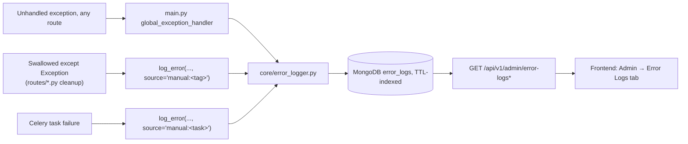

# Error Logging System

Every unhandled exception, plus a large number of previously "swallowed" `except Exception` blocks across the routes and Celery tasks (best-effort cleanup, non-fatal indexing/upload failures, etc.), are persisted to a dedicated `error_logs` MongoDB collection via `core/error_logger.py`'s `log_error()` helper — surfaced in the frontend's **Admin → Error Logs** tab.

## `log_error()` contract

```python
def log_error(
    exc: Exception,
    db,                     # AsyncIOMotorDatabase OR sync pymongo Database — auto-detected
    *,
    request=None,
    source: str = "manual",
    status_code: int | None = None,
    user_id: str | None = None,
    user_email: str | None = None,
    context: dict | None = None,
) -> None:
    ...
```

**Guarantees:**

- **Never raises.** All internal failures (including the Mongo insert itself) are swallowed with `logger.debug`, never propagated to the caller.
- **Never blocks.** In an async (Motor) context, the insert runs as a fire-and-forget `asyncio.create_task(...)`. In a sync (PyMongo) context — Celery tasks and the Meet Bot's raw PyMongo connection — it inserts directly, since there's no event loop to defer to.
- **Auto-detects the caller's DB type** so the same call is safe from both FastAPI routes and Celery tasks without branching at the call site.

**How it locates the failure:**

`_find_app_frame(exc)` walks `exc.__traceback__`, filters frames whose file lives under `backend/app/` and **not** under `site-packages`/`venv`/`.venv`, and takes the **deepest** matching frame (falling back to the innermost frame overall if nothing matches). From that frame it derives `module` (`__name__`), `function`, `file_path` (relative to `backend/`), and `line_number` — automatically, with no need to pass these manually at each call site.

**What gets captured** (document shape — see [Database Schema](../architecture/database-schema.md) for the full JSON): exception type/module, message (truncated 2000 chars), the auto-derived module/function/file_path/line_number, full traceback (truncated 20000 chars), a `source` tag (`http_exception_handler` for the global handler, `manual:<tag>` for an explicitly instrumented call site), the originating HTTP method/path/status code when applicable, and the requesting user's `user_id`/`user_email` — best-effort decoded from the request's `Authorization` header JWT (`verify_exp=False`) if not passed explicitly.

## Auto-expiry (TTL)

A MongoDB **TTL index** on `timestamp` deletes documents automatically after `ERROR_LOG_TTL_HOURS` (default 72h). Because MongoDB doesn't let you change a TTL value by simply recreating the index, `connect_db()` reconciles it via `db.command({"collMod": "error_logs", "index": {...}})` on **every startup**, so changing `ERROR_LOG_TTL_HOURS` and restarting the backend is sufficient — no manual index surgery needed.

## Three capture paths, one pipeline



## Frontend surface

`/dashboard/admin` → **Error Logs** tab: searchable/filterable list (module, source, status code, message substring, date range), paginated, a detail modal with the untruncated traceback, per-row delete, and a bulk clear-all action. Backed by `adminApi.errorLogs`/`errorLogDetail`/`deleteErrorLog`/`clearErrorLogs` in `frontend/src/lib/api.ts`.
