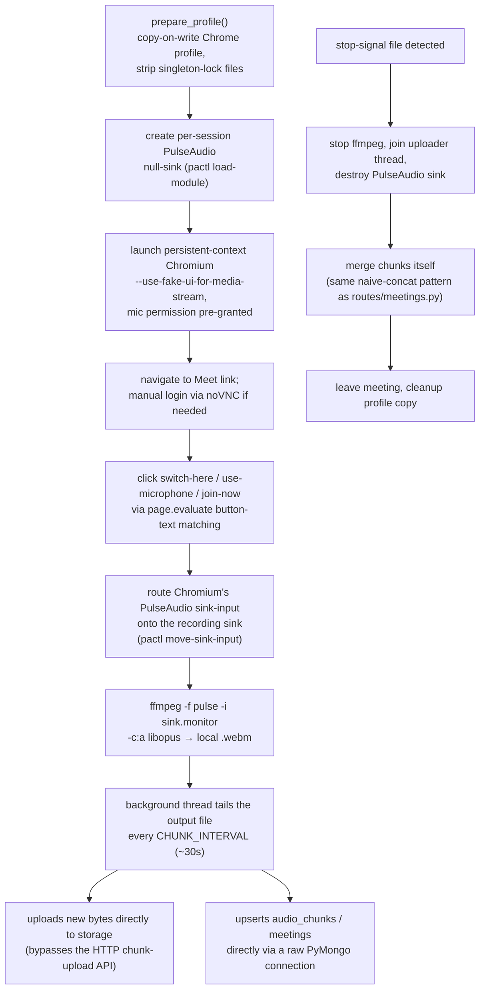

# Meet Bot Module (`backend/app/meet_bot/`)

An in-process automation module that drives a headless-but-visible (via noVNC) Chromium browser to join a Google Meet and record its audio. This is the **live, wired-in** Meet Bot implementation — invoked directly by backend routes, as opposed to the separately-deployed [Meet Bot Integration Service](../services/meet-bot-integration.md), which duplicates most of this same logic but is not currently called by the backend.

## Why login is manual, not token-based

`backend/docs/auth-analysis.md` explains this in depth: Google's Meet session relies on **browser session cookies**, which are a different system from OAuth access/ID tokens, and there is no Google endpoint that exchanges a Bearer token for those cookies. Google Identity Services' `storeCredential()` + One-Tap bridge is blocked by anti-automation detection and requires prior human consent. The only two viable approaches are:

1. **Password-based automated login** (via `BOT_GOOGLE_PASSWORD`) — technically possible but fragile against Google's bot detection.
2. **A from-scratch native WebRTC client** bypassing the browser entirely — correct but weeks of effort; not pursued.

The codebase implements a third, pragmatic option: **one-time manual login via noVNC**, with the resulting authenticated Chrome profile persisted and reused for all future recordings.

## `setup_login.py` — one-time Chrome profile login

`run_login(base_profile)`:

1. Launches a **non-headless** persistent-context Chromium, visible through noVNC on `MEET_BOT_NOVNC_PORT` (default 6080).
2. Navigates to `accounts.google.com` and polls every 5s, for up to `LOGIN_TIMEOUT` (default 300s), for a human to complete sign-in manually.
3. Verifies Meet access once signed in.
4. Copies the resulting profile directory to `CHROME_BACKUP_PROFILE` as a backup.

`profile_exists()` is a simple directory-existence check. Invoked by `routes/bot_setup.py::trigger_login` in a background thread; polled via `GET /api/v1/meetings/bot/setup/login/{task_id}`.

## `record_meeting.py` — the recording script

Invoked as a subprocess: `python -m app.meet_bot.record_meeting`, entirely configured via environment variables injected by `routes/bot_recording.py::start_bot_recording` (session/meeting IDs, PulseAudio sink names, Chrome profile paths, `MONGO_URI`, storage backend config).

Each mobile-style detail worth noting:

- **Concurrency-safe profiles**: each session gets its own copy-on-write Chrome profile directory (`/tmp/chrome-profile-rec-{SESSION_ID}`), so concurrent recordings don't collide; Chrome's singleton lock files are stripped from the copy.
- **Direct DB/storage access, bypassing the normal API path**: unlike the web/mobile chunk-upload flow (which goes through `POST /{id}/chunks`), the bot writes to storage and Mongo directly — meaning its data path has its own, independent merge logic (duplicated, not shared, with `routes/meetings.py::merge_audio_chunks`).
- **Graceful stop**: `routes/bot_recording.py::stop_bot_recording` writes a stop-signal file; the script polls for it (`check_stop_signal()`), and the route waits up to 60s for a clean exit before escalating to SIGTERM then SIGKILL.

## Routes that invoke this module

See [API Reference](api-reference.md) (the "Meet Bot recording" and "Meet Bot setup" sections) for the full endpoint tables. In short:

- `routes/bot_recording.py` (`/api/v1/meetings/bot/*`) — start/stop/status, tracked in an in-process `active_sessions` dict (thread-safe), independent of Celery.
- `routes/bot_setup.py` (`/api/v1/meetings/bot/setup/*`) — one-time login flow. **`POST /login` and `GET /login/{task_id}` have no auth dependency at all** — only `/status` and `DELETE /profile` require admin. See [Security Notes](../operations/security-notes.md).

## Deployment footprint

The entire GUI/audio automation stack — Xvfb, x11vnc/noVNC/websockify, PulseAudio, ALSA, ffmpeg, and Google Chrome Stable — ships **inside the main backend Docker image**, not as a separate container. `docker-compose-backend.yml`'s `api` service runs `privileged`, with `shm_size: 2gb` and `ipc: host`, both required for Chrome/Xvfb to function correctly in a container.
