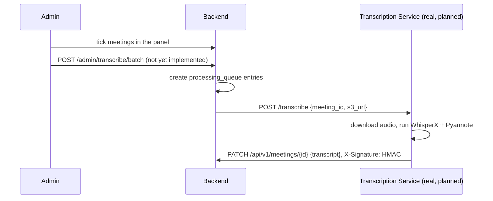

# Transcription Service (`transcription_service/`)

!!! danger "This is currently a mock/stub, not a working transcription pipeline"
    Both `app/main.py` and `app/pipeline.py` contain a real WhisperX + Pyannote implementation **entirely commented out**, with a "mock" implementation active in its place. Do not assume transcription happens here in the current deployment — treat everything below as either "what's actually running" (the mock) or "the documented target" (the commented-out plan), and don't confuse the two.

## What's actually active

- **`app/pipeline.py`**: `run_transcription_pipeline(audio_path)` ignores its input entirely and returns two hardcoded fake transcript segments.
- **`app/main.py`**: a FastAPI app self-titled `"Dummy Check Gateway (No HMAC / No GPU)"`. Single endpoint `POST /transcribe` (body: `meeting_id`, `user_id`, `s3_url`) validates non-empty fields, then in a `BackgroundTasks` job: logs a fake "downloading" message, calls the mock pipeline, and `httpx`-PATCHes the result to `{BACKEND_API_URL}/api/v1/meetings/{meeting_id}/transcript`.
- **No HMAC signature and no Authorization header are sent** with that callback.
- `requirements.txt` only lists `fastapi`, `uvicorn`, `pydantic`, `httpx` — none of the ML dependencies (torch/whisperx/pyannote/soundfile) are installed, confirming the GPU pipeline cannot run as-is.
- `docker-compose.yml`: the real GPU service block is fully commented out; the active service is `mock-transcription-service` on port `3001`, with `BACKEND_API_URL` hardcoded to a production IP.

## Two concrete bugs in the mock, if you ever try to wire it up

1. **Wrong callback path.** The mock PATCHes `/api/v1/meetings/{meeting_id}/transcript`. The real backend endpoint (confirmed in `backend/app/routes/meetings.py`) is `PATCH /api/v1/meetings/{meeting_id}` (a generic update, with `transcript` as one field of the body) — there is no `/transcript` sub-route. As written, this callback would **404**.
2. **Missing auth entirely.** `PATCH /api/v1/meetings/{meeting_id}` requires a valid Bearer JWT (`get_current_user`) for every caller. The mock sends no `Authorization` header, so even with the path fixed it would get **401 Unauthorized**. The backend additionally checks `X-Backend1-Signature` HMAC via `_verify_backend1_signature()`, but only as a secondary check gated on `BACKEND1_HMAC_SECRET` being set — the JWT requirement isn't satisfied by HMAC alone.

## The intended target architecture

The commented-out real pipeline would use **WhisperX `large-v3`** for transcription, word-level alignment, then **Pyannote `speaker-diarization-community-1`** for diarization, assigning speakers per word/segment by timeline overlap — and would HMAC-sign the callback body under an `X-Signature` header using `BACKEND1_HMAC_SECRET`.

`backend/docs/transcription-service-plan.md` documents the target flow explicitly, and states plainly that the current architecture is **"Polling + External Mock"**:

The plan document lists concrete file-by-file changes still needed: uncomment the real pipeline, add a `transcription_service_url` setting, add the `/admin/transcribe/batch` route, remove the auto-queue-on-merge behavior, and remove the Celery Beat polling schedule described in [Background Workers](../backend/workers.md). **None of these changes have been applied yet** as of this writing — treat the plan document as a roadmap, not current behavior.

## Environment

`.env` declares `BACKEND_API_URL`, `BACKEND1_HMAC_SECRET`, `HF_TOKEN`, `DEVICE`, `COMPUTE_TYPE`.

!!! danger "Security: rotate the Hugging Face token in this file"
    The `.env` file in this directory contains what looks like a **live** Hugging Face token value, not a placeholder. Verify it isn't committed anywhere in git history (`git log --all -p -- transcription_service/.env`), and rotate it regardless — treat it as a leaked credential until proven otherwise. See [Security Notes](../operations/security-notes.md).

## Related, currently-functional legacy path

`backend/app/routes/processing.py` (`POST /api/v1/processing/callback`) is the backward-compat callback endpoint this whole legacy poller talks to — see [Background Workers](../backend/workers.md) for `poll_processing_queue()` and [API Reference](../backend/api-reference.md) for the callback's own known `NameError` bug.
